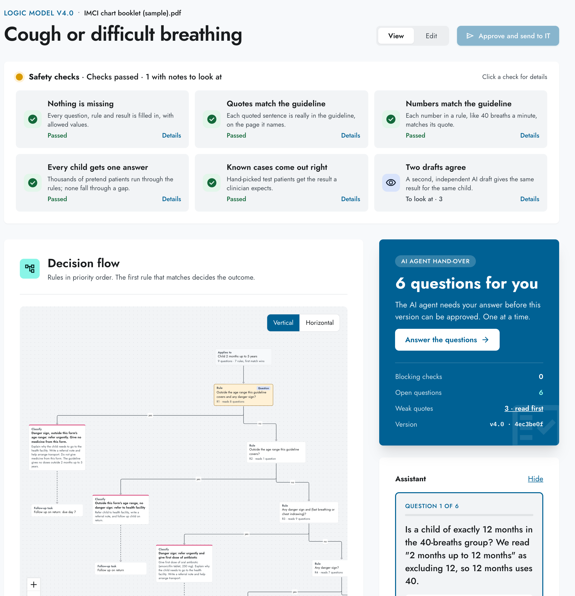
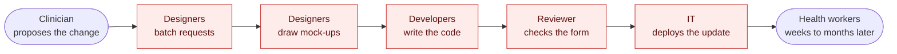
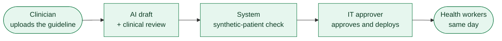
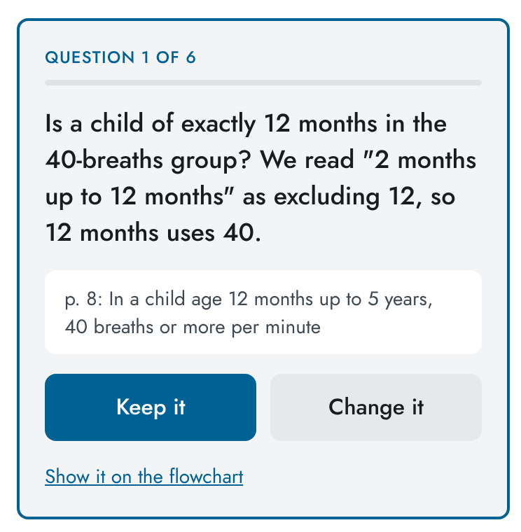
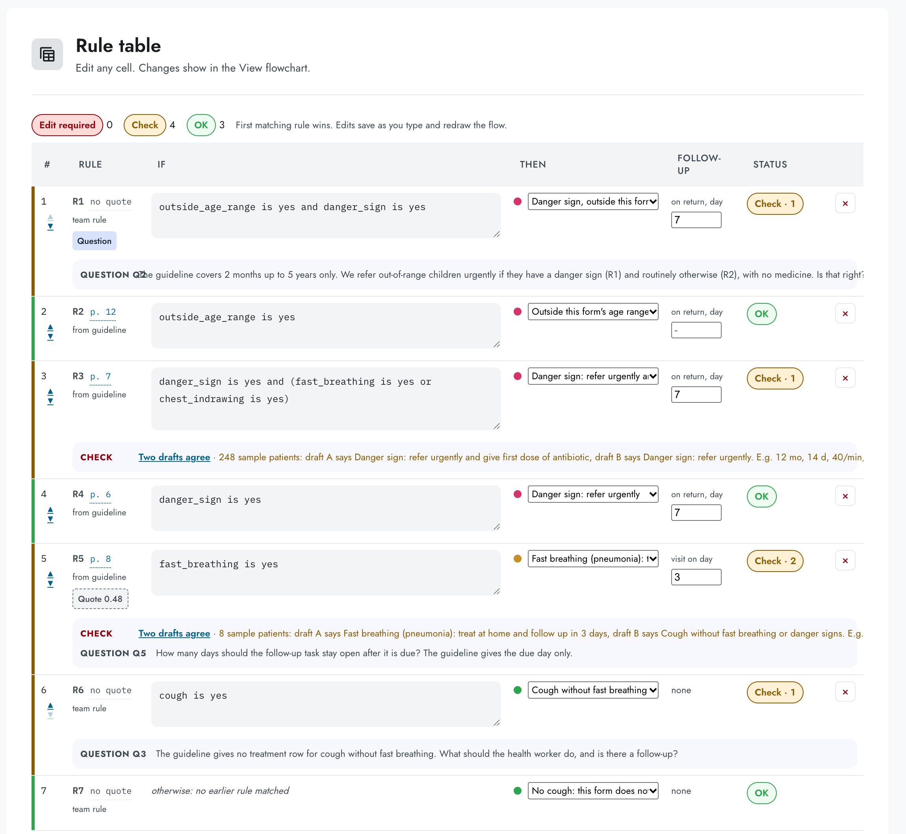
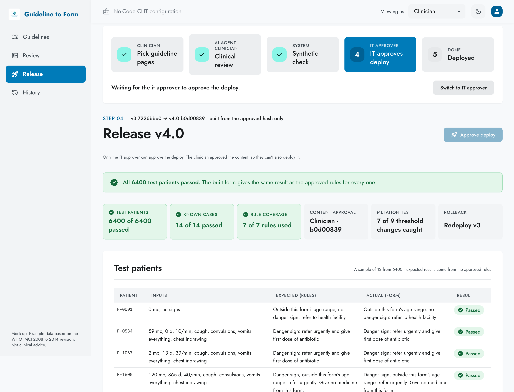
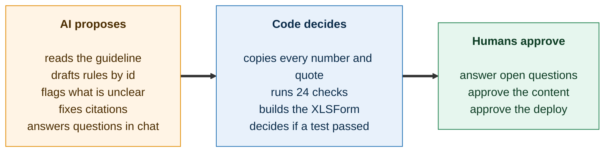
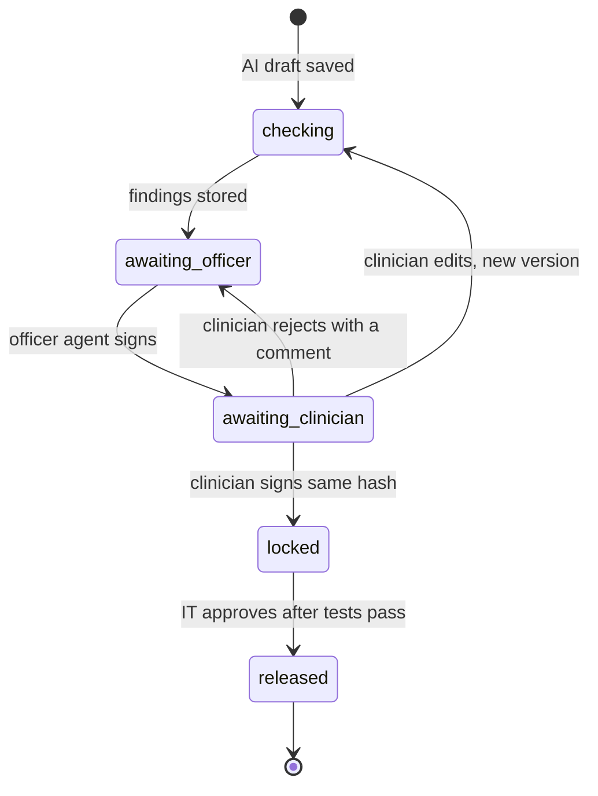
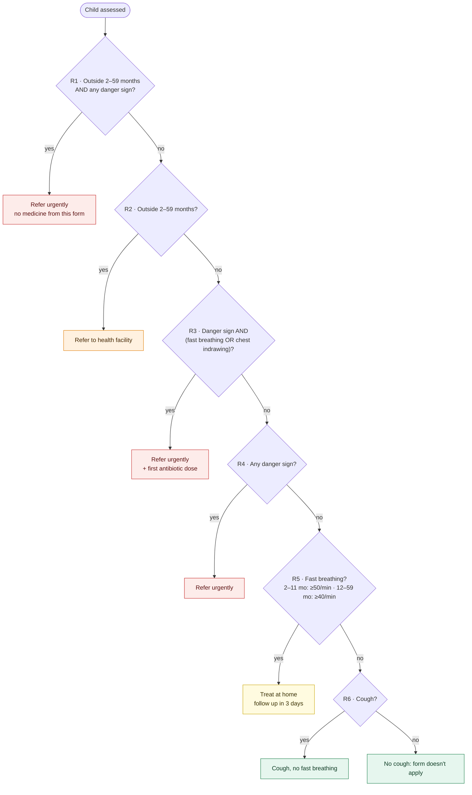
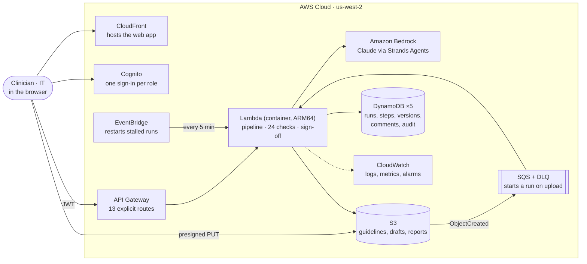

<div align="center">


# Guideline to Form
### No-Code CHT Configuration

**Clinicians turn a new health guideline into a safe, tested health-worker app in about 4 minutes, not months.**

*AWS Breaking Barriers Hackathon 2026 · Seattle · Team 1 · Built for [Medic](https://medic.org), steward of the [Community Health Toolkit](https://communityhealthtoolkit.org)*

[](#built-on-aws)
[](#built-on-aws)
[](Infra/)
[](Backend/)
[](Frontend/)
[](Backend/compile-demo/)
[](.github/workflows/ci.yml)

<br/>

| **~4 min** | **6,400** | **32 / 32** | **2** | **~$0.07** |
|:---:|:---:|:---:|:---:|:---:|
| guideline to tested form, instead of weeks to months | synthetic patients run on every version | known cases pass (12 confirmed by Medic) | human approvals, bound to one exact version | of Bedrock per AI draft (Claude Haiku 5.5) |

</div>

<p align="center">
  
</p>


---

**Contents:** [Problem](#the-problem) · [Solution](#our-solution) · [In action](#see-it-in-action) · [Safety](#safety-by-design) · [Logic model](#the-logic-model) · [CHT form](#the-built-cht-form) · [AWS](#built-on-aws) · [Repository](#repository-tour) · [Run it](#run-it-yourself) · [Next steps](#opportunities-for-improvement) · [Team](#team)

---

## The problem

The Community Health Toolkit serves **182,000+ community health workers in 24 countries**, and eight governments run it as their national community health platform. When medical evidence changes, those workers' apps have to change too, and today that is slow.

> **A treatment that cut child malaria deaths by 22.5% took over a year to reach DR Congo's national policy.**
> <sub>Sources: Dondorp et al., *The Lancet*, 2010 (AQUAMAT); Swiss TPH, MATIAS project</sub>

Every update passes through six handoffs, so even a five-minute label fix waits weeks to months:



Developers are few, feedback travels by email, and clinical meaning gets lost between medicine and code. **One dropped pair of brackets would have widened who sees 11 of 24 forms.** It slipped in after clinician approval, because no test harness existed.

---

## Our solution

We put the clinician in charge. They upload the guideline, AI drafts the decision logic, deterministic code checks it, builds the form and tests it, and two humans approve.



<table>
<tr>
<td width="33%" valign="top">

### 0 developer handoffs
The AI drafts from the guideline. The clinician reviews a **flowchart and a rule table**, never XLSForm, XPath or JavaScript.

</td>
<td width="33%" valign="top">

### Ambiguities fail loudly
Every unclear passage becomes a **question that blocks approval** until a person answers it. The AI never resolves ambiguity silently.

</td>
<td width="33%" valign="top">

### 2 human approvals
The clinician approves the **content**; IT approves the **deploy**. Each signature binds to one exact version hash.

</td>
</tr>
</table>

---

## See it in action

**The AI asks instead of guessing.** Where the guideline is unclear, the AI hands the clinician a question with the exact quote and page, and approval stays blocked until it is answered. Runs on the full booklet raised 13 such questions: **13 questions, not 13 guesses.**

<table>
<tr>
<td width="42%" valign="top"></td>
<td valign="top">

> **"Is a child of exactly 12 months in the 40-breaths group?"**

The booklet says *"2 months up to 12 months"* and *"12 months up to 5 years"*. Which group a 12-month-old falls into is a clinical judgment, so the AI flags it and waits for the clinician to **Keep it** or **Change it**.

</td>
</tr>
</table>

**Rules are edited in a table, not in code.** Every row shows its guideline page, and each change redraws the flowchart and reruns the checks.

<p align="center"></p>

**The built form is tested before IT sees it.** After the clinician approves, the system builds the form and runs 6,400 synthetic patients through it. IT sees the results, a mutation test and exactly what changed.

<p align="center"></p>

<sub>Screenshots from the frontend's sample mode (`VITE_API_URL= npm run dev`). In live mode the same screens call the orchestrator API.</sub>

---

## Safety by design

The design rule behind the code: **AI proposes, code decides, humans approve.**



| The AI is **never** allowed to | Enforced by |
|---|---|
| Write the configuration that ships | The compiler builds the form from the signed logic model only |
| Invent a number or quote | The draft names items by id; code copies every value from the extraction |
| Change rules, thresholds or outcomes on its own | A JSON-pointer allowlist (`Backend/src/guard/patchPaths.ts`) limits the officer agent to citations and bookkeeping |
| Judge whether a test passed | Expected outcomes come from the signed logic model |

### 24 deterministic checks on every version

AI drafts and human edits go through the same checks (`Backend/src/validation/checks/`):

<table>
<tr>
<td align="center" width="16%"><b>Golden set</b><br/><sub>12 human-annotated cases, approved by Medic</sub></td>
<td align="center" width="16%"><b>Completeness</b><br/><sub>Every possible patient gets exactly one result</sub></td>
<td align="center" width="16%"><b>Back to source</b><br/><sub>Every rule, quote and number traces to its page</sub></td>
<td align="center" width="16%"><b>Synthetic patients</b><br/><sub>6,400 patients; built form must match the logic</sub></td>
<td align="center" width="16%"><b>Urgent first</b><br/><sub>A milder result can never mask a danger sign</sub></td>
<td align="center" width="16%"><b>Two drafts agree</b><br/><sub>An independent second draft (Llama 4 Scout) must agree</sub></td>
</tr>
</table>

<details>
<summary><b>The other 18 checks</b></summary>

| Check | Catches |
|---|---|
| `schemaReferences` | A malformed draft, or a rule pointing at something that doesn't exist |
| `quoteGrounding` | A quote that isn't on the page it cites |
| `numberGrounding` | A threshold that doesn't match its quote, unit by unit |
| `inclusivityWording` | "50 or more" written as `>` instead of `>=` |
| `closedTable` | No catch-all rule at the end |
| `exclusivity` | Rules that overlap in a way that matters |
| `reachability` | A rule that never fires for any patient |
| `severityOrder` | A less severe outcome that wins over a fitting urgent one |
| `dangerSigns`, `dangerSignCoverage` | A danger sign that can be skipped or never asked |
| `ageBands`, `ageGroups` | Gaps or overlaps between age groups and dose bands |
| `useBeforeAsk` | A rule reading a question the form never asked |
| `deadInputs` | A question that never affects any outcome |
| `requiredQuestions` | A required answer that can be left blank |
| `followUpConsistency` | A follow-up for an outcome that doesn't exist, or a bad window |
| `clinicalText` | A referral outcome without clinical text |
| `fieldNames` | Field ids that aren't safe for XLSForm |
| `sourceCoverage` | Guideline passages with numbers that no rule cites |
| `openQuestions` | Signing while any question is still open |

</details>

### Approvals that code enforces

Every edit creates a new version with zero signatures. The officer agent signs first, the clinician second, and both signatures name the same version hash, so **what the signers saw is exactly what gets built**. A locked version can never change, and every version, rejection and model call stays in the audit log (`Backend/src/signoff/`).



---

## The logic model

The logic model is the guideline's decision-making written as data, one JSON file per version. The review table, the flowchart, the XLSForm, `tasks.js` and the expected test outcomes are all generated from it.

The pilot pathway is **child cough and fast breathing**, from the WHO/UNICEF iCCM booklet *Caring for the sick child in the community*. Rules run top to bottom and the first match wins:



<sub>**Danger sign:** cough 14+ days, chest indrawing, convulsions, not able to drink or feed, vomits everything, or unusually sleepy (booklet p. 6). Full write-up in [`Final_Logic_Model.md`](Final_Logic_Model.md).</sub>

---

## The built CHT form

The compiler (`Backend/src/compiler/`) turns a locked logic model into a standard CHT project (XLSForm, `tasks.js`, translations and a source map back to each guideline page), and **cht-conf 6.6.1** validates it. The form asks only the questions that can still change the outcome, **about 5 per visit instead of 9**, and the compiler refuses to build unless the short form gives the same result as the full one for every patient.

<table>
<tr>
<td align="center" width="25%"><br/><sub>One question per screen</sub></td>
<td align="center" width="25%"><br/><sub>Fast breathing: treat at home</sub></td>
<td align="center" width="25%"><br/><sub>Danger sign: refer urgently</sub></td>
<td align="center" width="25%"><br/><sub>Entry limits stop bad input</sub></td>
</tr>
</table>

---

## Built on AWS

A small team runs this **serverless and fully traceable** in `us-west-2`, defined end to end in AWS CDK (`Infra/`).



| Service | Role |
|---|---|
| **Amazon Bedrock** | Claude (default `us.anthropic.claude-haiku-5-5`) for extraction, drafting, the officer agent, revisions and chat; Llama 4 Scout for the independent second draft |
| **Strands Agents SDK** | Every model call goes through a Strands agent; optionally hosted on **Bedrock AgentCore** (`AgentService/`) |
| **Lambda + Web Adapter** | One container image runs the Fastify API, the SQS consumer and the scheduled resume sweep |
| **API Gateway (HTTP)** | 13 contract routes only, no `{proxy+}`; throttled; CORS locked to the UI origins |
| **S3 · SQS · DLQ** | Upload triggers a run; failed uploads land in a dead-letter queue after 5 tries |
| **DynamoDB** | Runs, steps, versions with signatures, comments and an append-only audit log; conditional writes stop double transitions |
| **EventBridge** | Every 5 minutes, resumes runs a 15-minute Lambda cut off |
| **Cognito** | Groups `clinician`, `program_officer`, `it`; a JWT authorizer on the API |
| **CloudFront** | Serves the React app |
| **CloudWatch** | Structured JSON logs, EMF metrics, dashboard and alarms |

**Surviving the 15-minute Lambda limit:** steps are idempotent, a succeeded step never re-runs, a DynamoDB lease stops two invocations advancing the same run, and each step gets at most 6 attempts before it fails cleanly.

**Cost:** about **$0.07 of Bedrock per AI draft** with Claude Haiku 5.5. `GET /runs/:id` reports tokens, cost and latency for every step, process and version, and an optional `RUN_BUDGET_USD` caps a run.

---

## Repository tour

```
.
├── Frontend/          React 19 + Vite review app (Guidelines · Review · Release · History)
│   └── src/           screens, flowchart (React Flow + dagre), in-browser checks, API client
├── Backend/           The orchestrator: Fastify API + pipeline + sign-off (TypeScript, Node 22)
│   ├── src/
│   │   ├── engine/      resumable run state machine with leases
│   │   ├── steps/       ingest · extract · fill_logic · checks
│   │   ├── validation/  the deterministic checks and plain-language findings
│   │   ├── agent/       the officer agent (Bedrock + code guards)
│   │   ├── guard/       patch allowlist, prompt-injection, budget, rate limit, redaction
│   │   ├── revision/    comments → instruction → structured edits
│   │   ├── signoff/     signatures, gates, lock, separation of duties
│   │   ├── compiler/    logic model → CHT project (XLSForm, tasks.js, sourcemap)
│   │   ├── chat/        read-only assistant with citations
│   │   ├── model/       Strands / Bedrock and AgentCore clients
│   │   └── store/       DynamoDB + S3 stores (and in-memory twins for tests)
│   ├── extraction/    Python ingest (poppler) and the versioned prompts
│   ├── cross-check/   the independent Llama 4 Scout draft
│   ├── scoring/       Strands Evals quote-support scorer (advisory)
│   ├── golden/        the 12 Medic-confirmed golden cases
│   ├── compile-demo/  logic model → real cht-conf → screenshots and report
│   └── tests/         ~117 Vitest suites
├── AgentService/      Optional Strands agent container for Bedrock AgentCore Runtime
├── shared/pathway/    Shared logic-model types, evaluator and flowchart builder
├── Infra/             AWS CDK: Data, Lambda, Web (+ optional AgentCore) stacks
├── Docs/              Stress test report, reviews, README images
├── claude_team/       BRD, system design, decision log (DEC-001…038), integration notes
├── DEPLOYMENT.md      Step-by-step AWS deployment, smoke test and teardown
└── Final_Logic_Model.md  The cough and fast breathing logic model, explained
```

---

## Run it yourself

**The UI on sample data, no backend:**

```bash
cd Frontend && npm ci && VITE_API_URL= npm run dev
```

**The real API locally, in memory with a fake model (no AWS):**

```bash
cd Backend && npm ci && npm run dev:local
```

```bash
cd Frontend && VITE_API_URL=http://localhost:8787 npm run dev
```

**Deploy to AWS** (needs Node 22+, AWS CLI v2, Docker and Bedrock access in `us-west-2`):

```bash
cd Infra && npm ci && npx cdk deploy --all -c modelId=us.anthropic.claude-haiku-5-5 -c uiOrigins=https://your-ui.example.org
```

The full guide, with bootstrapping, a smoke test and teardown, is in [DEPLOYMENT.md](DEPLOYMENT.md).

---

## Opportunities for improvement

The MVP covers one pathway from guideline to tested form. These are the areas we would take on next, roughly in order of impact.

| Area | Opportunity |
|---|---|
| **AI draft quality** | In the stress test, the live AI draft produced more blocking findings than the hand-written reference (45 against 14). Prompt tuning against the extraction eval, and feeding clinician rejection reasons back into later drafts, would narrow that gap. |
| **Build and test in the cloud** | The cht-conf compile runs on a build host today. Moving it, and the cht-conf-test-harness run of the built form, into an AWS step would make the synthetic-patient test of every release fully automatic. |
| **Release paths** | Add the urgent and standard release paths, with batching, so health workers who travel to sync receive fewer, larger updates. |
| **Production hardening** | Verify DynamoDB conditional writes against the live service, deploy the CloudWatch dashboard and alarms, rate-limit chat per user, and move long synchronous calls clear of API Gateway's 30-second limit. |
| **More pathways and inputs** | Extend beyond cough and fast breathing to diarrhoea, fever and malnutrition, and accept the other inputs Medic described: decision-table spreadsheets, clinician notes and local-language documents. |
| **Rollback** | Every version and build is already kept, so redeploying an earlier approved build is a small addition. |

Verification details for each component are in [DEPLOYMENT.md](DEPLOYMENT.md#9-what-is-not-verified) and the [stress test report](Docs/STRESS_TEST.md).

---

## Team

**Team 1, AWS Breaking Barriers 2026**

Shaurya Agarwal · Prithvi Hegde · Utkarsh Gupta · Niru Anbhazhakan · Vishnu Athreya · Akshaya Jonnalagadda

With thanks to **Medic** for the problem, the clinical review and the confirmed golden cases.

<div align="center">
<br/>
<sub>Built for the people who keep 182,000+ community health workers up to date. Synthetic data only. Not clinical advice.</sub>
</div>
